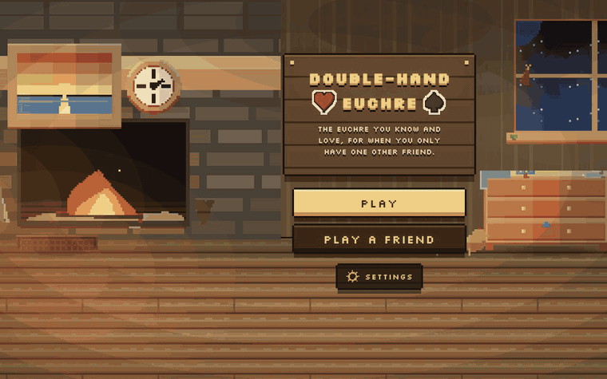
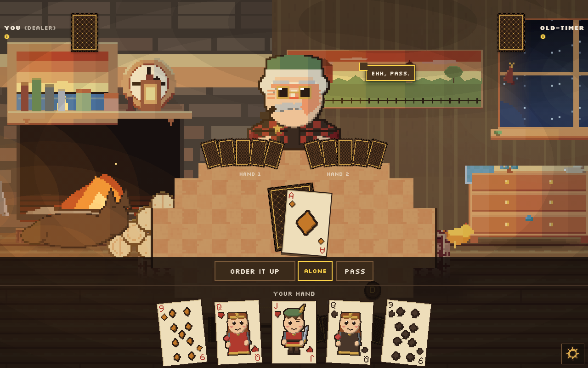
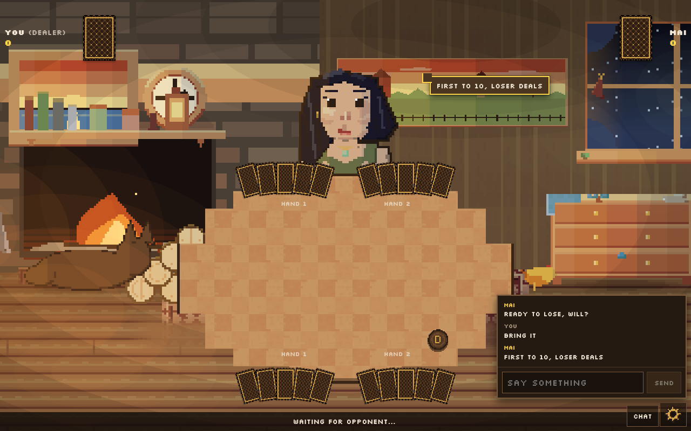
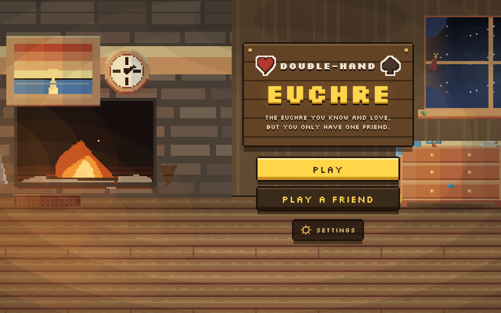
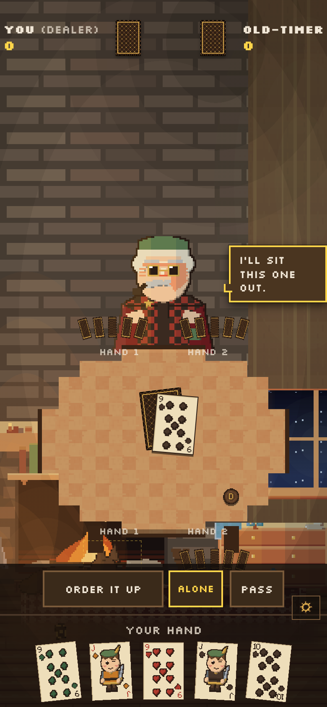
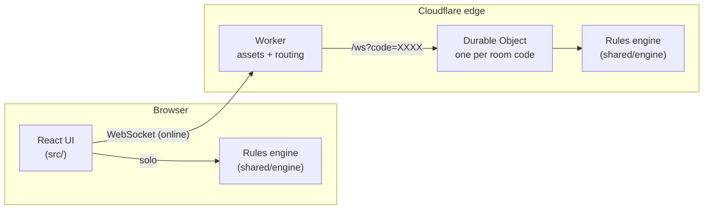

# Double-Hand Euchre

*The euchre you know and love, for when you only have one other friend.*

[](https://github.com/WillPaz16/double-hand-euchre/actions/workflows/ci.yml)
[](LICENSE)

**▶ Play it: [doublehand.willpaz16.workers.dev](https://doublehand.willpaz16.workers.dev)**, solo against a bot or online with a friend. No account, no install, works on a phone.



*A real game, recorded as it plays: pick a hand blind, bid, go alone, and play the first tricks
across the table from the Old-Timer.*

## A new way to play euchre

Euchre needs four players, and most nights there are two of you. The usual two-player fixes deal
each person one hand and one hand only, and they play like a different, thinner game.

**Double-Hand Euchre is a variant we invented to keep the real game.** Deal four hands, give each
player two, and each of you plays *both seats of a partnership*. It is standard four-handed euchre
underneath, so everything you know about bowers, ordering up and counting trump still applies.
What changes is what you're allowed to *see*:

1. **You play two hands.** Every trick has four cards, and two of them are yours.
2. **You pick one hand blind.** Before anyone looks, you choose which of your two face-down hands
   to pick up. The other stays down.
3. **You see one hand at a time.** Your blind hand plays every trick too, but you only see it on
   its own turn, then it flips back. Half your partnership lives in your memory.
4. **Going alone is a ladder.** The usual loner is worth 4. Commit *before you look at your hand*
   for 6, or before trump is even known for 8. The less you knew, the more it pays.

```
            the other player's two hands
         ┌───────────┐   ┌───────────┐
         │  Hand 1   │   │  Hand 2   │     all four hands play every trick,
         └───────────┘   └───────────┘     one card each, in a fixed ring
              ┌─────────────────┐
              │      table      │
              └─────────────────┘
         ┌───────────┐   ┌───────────┐
         │  Hand 1   │   │  Hand 2   │     yours: one picked blind and held,
         └───────────┘   └───────────┘     one you only see on its turn
                  your two hands
```

The full rules are in [RULES.md](RULES.md), written *before* the code and cited by number from the
tests. The game also teaches itself: open the rules panel from the title screen or the pause menu.

### What already existed

Euchre has had two-player versions since at least 1863, and some of this variant's ideas have
relatives. The closest we found ([Wikipedia's euchre variants](https://en.wikipedia.org/wiki/Euchre_variants)
lists them):

- **Two-handed euchre with extra hands.** Each player is dealt two hands but picks up only one, and
  may swap it for the other, sight unseen. Either way, each player plays a single hand.
- **Two-handed euchre with a dummy.** A small dummy hand is picked up after trump is called, and
  you build your best five cards from the eight.
- **Blind loners** are a house rule at some tables: going alone before looking at your cards,
  sometimes for 8 points.

What we couldn't find anywhere is the combination here: four hands dealt, each player holding
*both* seats of a partnership, one hand chosen blind and the other seen only on its own turn, and
going alone as a ladder priced by how much you knew when you committed. If you know of an older
version, please [open an issue](https://github.com/WillPaz16/double-hand-euchre/issues/new/choose).
We'd love to credit it.

## Why it's a game, not a gimmick

- **It reuses a game you already know.** A new variant lives or dies on whether people can sit down
  and play. Because this is real euchre with a twist in *information*, the table talk, the
  instincts and the bower arguments all carry over.
- **The memory strain is the game.** Nothing is written down and there is no log of played cards.
  You flip between your two hands several times a trick and have to remember what the one you
  can't see is holding. Playing one hand to set up the other is part of the puzzle.
- **The blind pick is a real decision with nothing to read.** You choose before seeing anything,
  and so does your opponent, at the same moment, so there is no tell and no turn order to exploit.
- **The loner ladder prices information.** Each tier is a bigger bet on less knowledge, with
  bigger points to tempt you, but only for a clean sweep. Fall short and you're euchred like
  anyone else.

| Going alone | You commit… | Points for a sweep |
|---|---|---|
| **Standard** | after seeing your hand, while naming trump | 4 |
| **Blind hand** | knowing trump (the upcard's suit), *before* seeing your hand | 6 |
| **Full blind** | before the upcard is even turned: nothing known | 8 |

The two blind tiers are this variant's own addition, so they're off by default: switch them on in
Settings, or propose them mid-game and they start next hand.

## What makes it fun to play

**The room**
- A pixel-art cabin with a crackling fire, a cat asleep by the hearth, snow falling past the
  window, and an old-timer across the table. **Every sprite is drawn by code**, and so is every
  sound. See [How it's built](#how-its-built).
- **Four characters to play against or as**, each with their own face and four expressions, and
  speech bubbles that react to how the hand is going.
- The upcard is revealed by a **slot-machine suit wheel** that clacks onto the real suit. Naming
  trump is a firm stamp, not a spin, because it's a choice and not chance.
- **The loner ladder is staged.** Going alone stamps the screen. A blind-hand loner dims the room,
  and a full-blind loner cuts the light to the fire alone: zero information in, zero light out.
- **Real euchre scoring.** The scoreboard is a 4 and a 6 laid over each other like cards on a
  real table, with a card physically sliding off the pips as your score climbs.
- Cards are picked up from their seat into your hand, tricks sweep to the winner, and the pixel
  art scales in whole-number steps so edges stay sharp from a 300px phone to an ultrawide monitor.

**Playing with a friend**
- **Online by four-letter room code or share link**, with reconnect-to-your-seat if you refresh
  or drop, and typed chat that pops up in your opponent's speech bubble.
- **Rules you agree on.** If your settings differ, both players choose before the first deal. A
  mid-game rule change is a proposal the other player accepts, and it starts next hand.
- **Hidden means hidden.** The server sends each player a view with only their own cards in it,
  so a modified client can't see an opponent's hand and can't play out of turn.

**Everywhere**
- Installable and **playable offline**: it's a PWA, and solo play needs no network.
- Suits are told apart by shape, not only colour. Screen-reader announcements for game state,
  keyboard play, and reduced-motion support.

<table>
  <tr>
    <td width="50%"></td>
    <td width="50%"></td>
  </tr>
  <tr>
    <td width="50%"></td>
    <td width="50%" align="center"></td>
  </tr>
</table>

## Designing a rules variant

Inventing a variant means finding the places where "just play two hands" quietly breaks. A few
that took real design work, each settled in [RULES.md](RULES.md):

- **What is a "hand" when one person plays two?** Seats alternate `A1, B1, A2, B2`, so your two
  hands are partners and the ring of play is fixed for the whole deal. The lead passes to whichever
  *specific hand* won the last trick, which is standard euchre applied one level down.
- **A loner makes a three-hand trick**, and a ring can't alternate three hands between two people.
  Walked naively, it put the defender's two hands back to back, forcing them to commit both cards
  before the loner had shown anything. The fix pulls the loner's hand into second place whenever a
  defender leads.
- **The 6-point tier was first designed backwards.** An early draft had you see your hand and
  declare before trump, which makes naming trump blind the gamble. The tiers only price correctly
  the other way around (trump known, hand unseen), and the spec records why.
- **Blind selection is simultaneous**, not taken in turns, because choosing reveals nothing and
  there is nothing to wait for.
- **A hidden-information game is a security problem online.** The blind hand has to stay secret
  from a client that is trying to peek, which shaped the whole server design below.

## How it's built



**One rules engine, two homes.** `shared/engine` is a pure TypeScript reducer with no DOM and no
network, seeded so every deal is reproducible. Solo play runs it in the browser; online play runs
the *same code* on the server, so the two modes can't disagree about the rules.

**The server is authoritative.** Clients send intentions. The room checks each one against the
engine's legal moves for *that connection's* seat, and sends every player a view redacted for
their eyes only. A modified client can't see hidden cards or play out of turn, because the move
simply isn't in its legal list.

**One Durable Object per room.** The room code *is* the object's identity, so Cloudflare
guarantees exactly one instance of each game worldwide: no single server to outgrow and no
split-brain. Sockets use the Hibernation API, so an idle game costs nothing, and the whole thing
runs on Cloudflare's free tier, with per-IP rate limits so a flood of guessed room codes can't
burn the daily budget.

**Art and audio are generated by code.** Every card, character, and piece of the cabin is drawn
by a deterministic Python generator ([`art/generate_art.py`](art/generate_art.py)), and every
sound is synthesized from waveform math ([`art/generate_audio.py`](art/generate_audio.py)). There
are no hand-painted or model-generated asset files, and regenerating is pixel-identical. The
rules for keeping it crisp (a whole-pixel scale, a banded value ladder, a colour ceiling per
sprite) are written down in [art/ASSETS.md](art/ASSETS.md) and enforced by checks, not by eye.

**Hardened for the open web.** A strict Content Security Policy and the usual browser security
headers, no accounts and no stored personal data, and a private route for
[security reports](SECURITY.md).

## Quality gates

Every pull request and every push to `dev` or `main` runs these in CI. Nothing deploys unless all
of them pass.

| Check | What it guards |
|---|---|
| 230+ unit & component tests (Vitest) | rules, scoring, room logic, multiplayer protocol, UI behavior, crash and storage fallbacks |
| 10,000-deal fuzz | random legal play under random rule settings never reaches an illegal state |
| Layout audit (Playwright) | 11 screen sizes: whole-pixel art scaling, UI/scenery collisions, edge anchoring, hand-fan spacing |
| Art checks | two generator runs are pixel-identical, card art is unchanged, sprites have no holes |
| Production build | the app and the Worker both type-check and build |
| Multiplayer smoke test | two real WebSocket clients against the Worker under `wrangler dev`: seating, hidden cards, turn enforcement, reconnect, a full game and a rematch |
| Post-deploy smoke test | the same test against the live URL right after each deploy |

## Tech stack

| | |
|---|---|
| Client | React 19, TypeScript, Vite, vite-plugin-pwa |
| Server | Cloudflare Workers, Durable Objects (SQLite storage), Hibernatable WebSockets |
| Testing | Vitest, Testing Library, Playwright |
| Assets | Python + Pillow (sprites), stdlib `wave` (audio) |
| CI/CD | GitHub Actions → Wrangler; `dev` and `main` deploy to separate staging and production Workers |

## Running it locally

Requires Node 22+.

```bash
npm install
npm run dev        # the game with hot reload, http://localhost:5173
npm run worker     # multiplayer server on :8787 (run `npm run build` once first)
```

Solo play needs only `npm run dev`. Other useful scripts:

```bash
npm test           # unit and component tests
npm run fuzz       # 10,000 random deals
npm run audit      # layout audit across 11 screen sizes
npm run typecheck && npm run typecheck:worker
```

To regenerate art or audio (Python 3.11+):

```bash
pip install -r art/requirements.txt
python3 art/generate_art.py && npm run art:check
python3 art/generate_audio.py
```

When editing the characters, `python3 art/check_avatar_posture.py` compares the sprites against
the last commit.

## Project layout

```
src/            React app: screens, table, hooks, styles
shared/engine/  pure rules engine (deal, bidding, loners, tricks, scoring, redaction)
shared/net/     room logic and wire protocol, shared by client and server
shared/bot/     the solo opponent
worker/         Cloudflare Worker and the per-room Durable Object
tests/          Vitest suite
scripts/        fuzz, layout audit, multiplayer smoke test, bot balance
art/            asset generators, checks, and the art spec (ASSETS.md)
public/         generated sprites and audio
docs/           README screenshots
```

Reading the code? [`shared/engine/`](shared/engine) is the best place to start: it's pure
TypeScript with no DOM and no network, so the whole game is legible without a browser.
[`shared/net/room.ts`](shared/net/room.ts) is the multiplayer rules on top of it, and
[`worker/room-object.ts`](worker/room-object.ts) is the server that holds one room.

## Docs

| File | What's in it |
|---|---|
| [RULES.md](RULES.md) | The complete rules, and the reference the engine is built from. Starts with a summary for people who already know euchre. |
| [art/ASSETS.md](art/ASSETS.md) | How every sprite is drawn by code, and the rules that keep it all crisp and consistent. |
| [DEPLOY.md](DEPLOY.md) | Environments, the deploy pipeline, and running it locally. |
| [CONTRIBUTING.md](CONTRIBUTING.md) · [SECURITY.md](SECURITY.md) | Working on it, and reporting a problem privately. |

## Where it could go next

- **A stronger opponent.** Today's bot is a hand-written heuristic, tuned against a baseline. It
  sits behind one function (`chooseMove`), so a search-based or self-play-trained bot can drop in
  without touching the engine, and the engine's seeded replay makes that practical.
- **The blind tiers need more play.** The bot never gambles on the 6 and 8-point tiers, so
  they've only been tested by people. Playing them is what will say whether 4 / 6 / 8 is the right
  ladder.

## License

[MIT](LICENSE) © 2026 Will Paz
